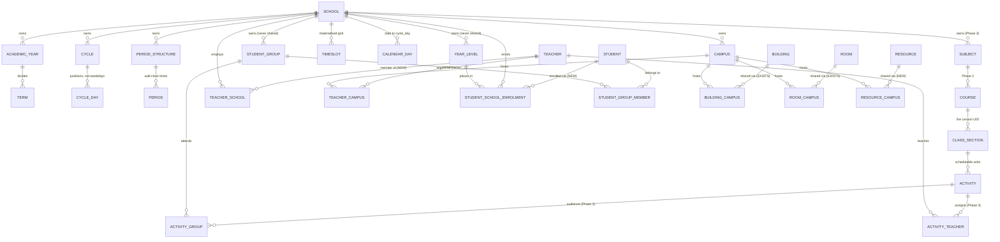

# Multi-school architecture audit and migration feasibility report

- Date: 2026-10-13
- Status: **Stage 0A implemented and approved; every later stage still a proposal.**
  Stage 0A is §15's first stage: the migration, school CRUD, school-scoped reads and the
  cross-school integrity triggers, recorded as
  [adr/0019](adr/0019-multiple-schools-in-one-project.md) and
  [adr/0020](adr/0020-in-place-table-rebuild.md). Stages 0B, 0C and A-D below, and the
  decisions in §16 that they depend on, are **not** approved and **not** built.
- Branch: `feat/school-setup-lessons-and-roster-import` (audit only; no commits)
- Repository state audited: `origin/develop` at `3ce40f1`, schema `V11`, working tree clean

## How to read this document

Every claim is tagged:

- **[VERIFIED]** — read out of the repository, or executed against a real SQLite database
  during this audit. The proof is cited.
- **[PROPOSED]** — a design recommendation. Not implemented, not binding until approved.
- **[OPEN]** — a decision that needs your answer; collected in §16.

Supersedes the earlier audit
`docs/prompt-runs/2026-10-13-school-setup-lessons-and-roster-import-audit.md`, which was
written under the single-school premise. **One of its findings was wrong and is corrected
in §2.3.**

---

## 1. Executive summary

Supporting multiple schools in one `.evaraproj` is **substantially cheaper than expected,
and the cost is not where the previous audit put it.**

1. **Exactly one table blocks it.** `school.only_one` is the only structure in the schema
   that enforces a single school. **[VERIFIED]**
2. **Every other uniqueness rule is already school-scoped and already correct.** `UNIQUE
   (school_id, name)` and `UNIQUE (school_id, ordinal)` on `year_level` — which the
   previous audit called a permanent blocker — turn out to deliver the brief's §8
   requirement with **no schema change at all**, the moment a second `school` row exists.
   Proven by execution in §11.4. **[VERIFIED]**
3. **The `school` rebuild is safe, forward-only, and runs inside refinery's existing
   grouped transaction.** `PRAGMA defer_foreign_keys` is honoured inside a transaction
   where `PRAGMA foreign_keys` is not. Dropping and recreating `school` *in place* — same
   name, so no referencing FK clause is rewritten — preserves every id, passes
   `foreign_key_check`, and rolls back completely on failure. Proven on the exact engine
   Evara ships, SQLite 3.50.2. **[VERIFIED — §11]**
4. **Facility sharing across schools already works.** `building_campus` and `room_campus`
   (ADR 0013/0014) link facilities to campuses, not to schools. Once campuses belong to
   different schools, a shared classroom is expressible with **zero** schema change.
   **[VERIFIED]**
5. **The real work is the single-school assumption in the code, not the schema.** No list
   query in `repo/people.rs` filters by `school_id` — 0 occurrences — because there has
   only ever been one school. `structure.rs` has 1, `time_model.rs` has 2. Combined with
   119 Tauri commands and ~20 frontend files that receive one `School` from a
   `LIMIT 1` query, this is the dominant cost of Stage 0A. **[VERIFIED]**
6. **Cross-school scheduling is the genuinely hard part, and it is not a migration
   problem.** Cycle positions are not comparable between schools; only a projection to
   dated UTC instants is sound, and two schools in one project may be in different
   timezones. Independent per-school solving plus after-the-fact conflict detection
   **cannot** guarantee a valid project-wide timetable. §10 sets this out and bounds what
   may be promised.

The recommended sequence is four foundation stages before the previously planned work,
with the hardest item — coordinated cross-school solving — deliberately deferred behind a
documented soundness boundary rather than half-built.

---

## 2. Current architecture limitations

### 2.1 The singleton, exactly as it stands

`crates/evara-db/migrations/V3__structure_static.sql`: **[VERIFIED]**

```sql
CREATE TABLE school (
    id         TEXT    PRIMARY KEY NOT NULL,
    only_one   INTEGER NOT NULL DEFAULT 1 CHECK (only_one = 1) UNIQUE,
    ...
```

`CHECK (only_one = 1)` forces the value; `UNIQUE` permits one row holding it. Both are
**table-level** constraints, so neither can be dropped by `ALTER TABLE`. The migration's
own comment cites ADR 0003: *"One school per project … Multiple schools means multiple
project files."* `OPEN-DECISIONS.md` D20 records it as settled.

`V7__school_working_days.sql` later added `working_days` by `ALTER TABLE`, so the live
table is the V3 definition plus that column. Any rebuild must reproduce both. **[VERIFIED]**

### 2.2 What the singleton does *not* constrain

14 tables reference `school (id)`, all `ON DELETE RESTRICT`: `campus`, `room_type`,
`resource`, `academic_year` (V3); `cycle`, `period_structure`, `timeslot`, `calendar_day`
(V4); `school_logo` (V8); `year_level`, `teacher`, `student`, `student_group` (V10);
`availability` (V11). **No trigger or view anywhere in the schema names `school`**, so a
rebuild has no trigger dependencies to recreate beyond the change-log triggers, which are
reinstalled automatically (§11.6). **[VERIFIED]**

### 2.3 Correction to the previous audit

The previous audit's Finding 2 stated that `year_level` *"can never hold two rows with the
same name"* and that the brief's §8 requirement was *"unreachable in this schema"*.

**That was wrong.** It reasoned correctly about a fixed `school_id` and then failed to
re-examine the premise this brief changes. `UNIQUE (school_id, name)` only collapses to
`UNIQUE (name)` while there is one school. With two school rows the constraint does
precisely what is wanted, and §11.4 demonstrates Grade 1 existing in both schools, with
distinct UIDs and the same ordinal, while a duplicate *within* one school is still
refused. The brief's own §8 reading — *"compatible … once multiple school records are
supported"* — is correct, and no year-level constraint should be touched. **[VERIFIED]**

### 2.4 Single-school assumptions in code **[VERIFIED]**

| Location | Assumption |
| --- | --- |
| `repo/structure.rs:253-255` | `school()` returns `Option<School>` from `SELECT … FROM school LIMIT 1` |
| `repo/structure.rs:342`, `:438` | `school_logo` read with `LIMIT 1` |
| `repo/people.rs` | **0** `WHERE school_id` clauses; `year_level`, `teacher`, `student`, `student_group` list queries are unscoped |
| `repo/structure.rs` / `time_model.rs` | 1 and 2 `WHERE school_id` clauses respectively |
| `commands/structure.rs:64` | `get_school` returns the singleton to the interface |
| ~20 files under `apps/desktop/src/app` | take `school: School` from one `getSchool()` call |
| 119 `#[tauri::command]` handlers | `structure` 48, `time_model` 28, `people` 25, `project` 8, `availability` 5, `grid` 4, `mod` 1 |

### 2.5 Cross-school consistency hazards latent in the current schema **[VERIFIED]**

Several tables carry both a `school_id` and an optional reference that *could* point into a
different school once more than one exists. Nothing checks them today because nothing
could disagree:

| Table | Columns that could disagree |
| --- | --- |
| `student` | `school_id` vs `year_level_id`, `campus_id` |
| `student_group` | `school_id` vs `year_level_id`, `parent_group_id`, `campus_id` |
| `room` | `campus_id` (campus → school) vs `room_type_id` (school-owned) |
| `resource` | `school_id` vs `campus_id` |
| `period_structure` | `school_id` vs `campus_id` |
| `calendar_day` | `school_id` vs `term_id`, `campus_id`, `cycle_day_id` |
| `availability` | `school_id` vs `timeslot_id`, `cycle_day_id`, `period_id`, `term_id` |

`timeslot` is the exception: V4 already has
`timeslot_derived_columns_must_agree_insert/update` asserting that its school, cycle and
campus match the cycle day and period it was built from. That trigger is the **precedent
and the template** for the rest. **[VERIFIED]**

### 2.6 Availability is not ready for a shared entity **[VERIFIED]**

```sql
CREATE UNIQUE INDEX idx_availability_identity ON availability (
    entity_kind, entity_id,
    COALESCE(timeslot_id, ''), COALESCE(cycle_day_id, ''),
    COALESCE(period_id, ''), COALESCE(term_id, ''));
```

`school_id` is **absent from the identity index**, while `availability.school_id` is
`NOT NULL`. For a project-level shared teacher that is incoherent: the rule must name a
school, but the identity that prevents duplicates ignores which school named it. It is a
standalone `CREATE UNIQUE INDEX`, so unlike a table constraint it can simply be dropped
and recreated. **[VERIFIED]**

### 2.7 Wall-clock times are not comparable between schools **[VERIFIED]**

`V4` stores `period.starts_at` / `ends_at` as `'HH:MM'` text, and its comment is explicit:
*"timezone lives on `school`, and a bell schedule is a wall-clock thing, not an instant."*
With one school per file that is sound. With two schools in one file — potentially
`Australia/Sydney` and `Australia/Perth` — "10:00" in School A and "10:00" in School B are
three hours apart. Any cross-school comparison of bell times is therefore wrong unless
projected through each school's own timezone. **[VERIFIED]**

---

## 3. Proposed project / school / campus hierarchy **[PROPOSED]**

```text
.evaraproj  (project identity lives in app_meta: project_id, created_by_site_id)
│
├── PROJECT-LEVEL IDENTITIES — one row per real-world thing, never duplicated per school
│   ├── teacher                 + teacher_school (membership) + teacher_campus (eligibility)
│   ├── student                 + student_school_enrolment (enrolment history)
│   ├── building / room         already shareable across campuses (ADR 0013/0014)
│   └── resource                + resource_campus (proposed, mirrors room_campus)
│
└── SCHOOL-OWNED, never shared
    ├── campus  ──> building_campus / room_campus reach ACROSS schools
    ├── academic_year ──> term
    ├── year_level
    ├── cycle ──> cycle_day
    ├── period_structure ──> period        (period_structure.campus_id already exists)
    ├── calendar_day, timeslot
    ├── student_group ──> student_group_member
    └── subject ──> course ──> class_section ──> activity        (Phase 3, not yet built)
```

**No `project` table is proposed.** Project identity already lives in `app_meta`
(`project_id`, `created_by_site_id`, V2 and ADR 0008). A table would duplicate it and
create a second source of truth. "Project-level" means *not scoped by `school_id` in
queries* — not *owned by a project row*.

**`school_id` is retained on every project-level entity as the *home* school.** This is
ADR 0013/0014's pattern applied a third time: `building.campus_id` and `room.campus_id`
survived as home campuses because they are undroppable and because they guarantee an
entity can never reach zero associations. The same reasoning holds here, and it keeps the
migration additive: no rebuild of `teacher`, `student` or `resource`.

---

## 4. Entity ownership and sharing matrix **[PROPOSED]** unless marked

Legend — Scope: **P**roject, **S**chool, **C**ampus. "Join needed": a membership table is
required. "Uniqueness": where the name/code rule should apply after the change.

| Entity | Exists | Scope | Shareable | Join needed | Uniqueness | Schema change |
| --- | --- | --- | --- | --- | --- | --- |
| project identity | yes (`app_meta`) | P | — | no | n/a | none |
| `school` | yes | P | — | no | `name` unique; optional `code` unique when given | **rebuild** — drop `only_one`, add `code` |
| `campus` | yes | S | no | no | `(school_id, code)` **[VERIFIED already correct]** | none |
| `building` | yes | C (home) | **yes** | `building_campus` **exists** | `(campus_id, name)` | none |
| `room` | yes | C (home) | **yes** | `room_campus` **exists** | `(campus_id, code)` | none; add cross-school `room_type` check |
| `room_type` | yes | S | no | no | `(school_id, code)` | none; enforce vs `room.campus_id` |
| `resource` | yes | S (+ optional campus) | **yes, proposed** | `resource_campus` **new** | `(school_id, code)` | new join table |
| `teacher` | yes | **P** | **yes** | `teacher_school`, `teacher_campus` **new** | `code` project-wide **[OPEN 4]** | 2 join tables; swap one index |
| `student` | yes | **P** | **yes** | `student_school_enrolment` **new** | admission no. per school **[OPEN 5]** | 1 join table; swap one index |
| `department` | **no** (Phase 2 gap) | S | no | no | `(school_id, code)` | new table (V13) |
| `subject` | **no** (Phase 2 gap) | S | no | no | `(school_id, code)` | new table (V13) |
| `teacher_qualification` | **no** | P or S **[OPEN 6]** | — | — | `(teacher_id, subject_id)` | new table (V13) |
| `academic_year` | yes | S | no | no | `(school_id, name)` **[VERIFIED correct]** | none |
| `term` | yes | S (via year) | no | no | `(academic_year_id, ordinal/name)` | none |
| `year_level` | yes | **S** | **never** | no | `(school_id, name)`, `(school_id, ordinal)` — **[VERIFIED correct as-is]** | **none** |
| `student_group` | yes | S | never | no | `(school_id, name)` | none; add cross-school checks |
| `student_group_member` | yes | S (via group) | — | no | `(group, student)` | none |
| `cycle` | yes | S, copy-on-adopt | **[OPEN 7]** | no | `(school_id, name)` | none |
| `cycle_day` | yes | S (via cycle) | with its cycle | no | `(cycle_id, ordinal/label)` | none |
| `period_structure` | yes | S (+ optional campus) | no | no | `(school_id, name)` | none |
| `period` | yes | S (via structure) | no | no | `(period_structure_id, ordinal/label)` | none |
| `calendar_day` | yes | S | never | no | identity index incl. school chain | none |
| `timeslot` | yes | S | never | no | `(cycle_day, period, term)` | none |
| `availability` | yes | S **and** P **[OPEN 8]** | — | no | identity index must gain `school_id` | drop/recreate one index; possible rebuild |
| `course` | **no** (Phase 3) | S | never | no | `(school_id, code)` | new (V14) |
| `class_section` | **no** (Phase 3) | S | never | no | `(course_id, code)` | new (V14) |
| `class_teacher` / `class_group` | **no** | S (via section) | — | — | composite | new (V14) |
| `enrolment` (class) | **no** | S (via section) | — | — | `(section, student)` | new (V14), **rename — §7.3** |
| `activity` | **no** (Phase 3) | S | never | no | — | new (V15) |
| `activity_teacher` / `activity_group` | **no** | S (via activity) | — | — | composite | new (V15) |
| `timetable` / `timetable_entry` | **no** (Phase 6) | S | never | no | — | later |
| scheduling constraints | **no** (Phase 4) | S, **plus project-level for shared entities [OPEN 9]** | — | — | — | later |

Deliberately **not** shareable: `year_level`, `student_group`, `course`, `class_section`,
`activity`, `calendar_day`, `timeslot`, `academic_year`, `term`. Each is an expression of
one school's academic structure, and sharing any of them would make a cross-school
reference representable — the thing §2 of the brief requires be rejected.

---

## 5. Revised ER diagram **[PROPOSED]**



`TEACHER`, `STUDENT`, `BUILDING`, `ROOM` and `RESOURCE` are the project-level identities;
everything hanging off `SCHOOL` is school-owned. The only edges that cross a school
boundary are the four membership/sharing tables, which is what makes "reject cross-school
assignment" a checkable rule rather than a slogan.

---

## 6. Shared teacher design **[PROPOSED]**

```sql
-- Membership: which schools employ this person. The authority.
CREATE TABLE teacher_school (
    id          TEXT    PRIMARY KEY NOT NULL,
    teacher_id  TEXT    NOT NULL REFERENCES teacher (id) ON DELETE RESTRICT,
    school_id   TEXT    NOT NULL REFERENCES school  (id) ON DELETE RESTRICT,
    department_id TEXT           REFERENCES department (id) ON DELETE SET NULL,  -- V13
    -- Per-school employment state: "left School A, still at School B".
    is_active   INTEGER NOT NULL DEFAULT 1 CHECK (is_active IN (0, 1)),
    created_at  TEXT    NOT NULL,
    updated_at  TEXT    NOT NULL,
    rev         INTEGER NOT NULL DEFAULT 1 CHECK (rev >= 1),
    UNIQUE (teacher_id, school_id)
) STRICT;

-- Eligibility: a NARROWING of membership, never an independent claim.
CREATE TABLE teacher_campus (
    id         TEXT    PRIMARY KEY NOT NULL,
    teacher_id TEXT    NOT NULL REFERENCES teacher (id) ON DELETE RESTRICT,
    campus_id  TEXT    NOT NULL REFERENCES campus  (id) ON DELETE RESTRICT,
    created_at TEXT    NOT NULL, updated_at TEXT NOT NULL,
    rev        INTEGER NOT NULL DEFAULT 1 CHECK (rev >= 1),
    UNIQUE (teacher_id, campus_id)
) STRICT;
```

Both are **full entity tables, not bare junctions** — own UUIDv7 `id`, own audit columns,
own change-log triggers, own `TRACKED_TABLES` entry. V5, V6 and V10 all record the reason:
the triggers read `NEW.id` and `NEW.rev`, and `repo::update`/`repo::delete` address rows by
`id`, so a composite-key table sits outside the change feed.

### Both relationships, with the inconsistency made impossible

The brief warns against redundant relationships that can drift, and names the exact
failure: *a teacher belongs to School A but is eligible for a campus of School B.* Three
models were considered:

| Model | Why not / why |
| --- | --- |
| `teacher_school` only; eligibility = all campuses of member schools | Cannot express "School A, Junior Campus only", which is the common part-time arrangement |
| `teacher_campus` only; membership derived from `campus.school_id` | Cannot express membership of a school before its campuses are configured, and has nowhere to hang per-school department or employment state |
| **Both, with `teacher_campus` constrained to campuses of member schools** | **Recommended.** Expresses both granularities; the drift the brief names is rejected by the database rather than by convention |

The constraint is a trigger pair, exactly like V6's *"a room's building must be available
on every campus the room serves"*:

```sql
CREATE TRIGGER teacher_campus_requires_school_membership_insert
BEFORE INSERT ON teacher_campus FOR EACH ROW
BEGIN
    SELECT RAISE(ABORT, 'a teacher''s campus must belong to a school they are a member of')
    WHERE NOT EXISTS (
        SELECT 1 FROM campus
        JOIN teacher_school ts ON ts.school_id = campus.school_id
        WHERE campus.id = NEW.campus_id AND ts.teacher_id = NEW.teacher_id
    );
END;
```

So eligibility is *recorded* (it carries information membership does not) but can never
contradict membership. Deleting a `teacher_school` row must therefore first clear the
dependent `teacher_campus` rows, in the same transaction, through `repo::delete` — the
pattern `delete_student_group` already uses.

### Consequences and migration

- `teacher.school_id` becomes the **home school**; `teacher_school` is the complete
  membership set. Nothing reads `teacher.school_id` to answer "which schools?".
- Backfill inserts one `teacher_school` row per existing teacher naming its current
  `school_id`, and one `teacher_campus` row per teacher that has a `home_campus_id`,
  reusing the teacher's own `created_at` so no revision is consumed and no teacher row is
  rewritten. Same shape as V6's backfill. **No existing association is lost.**
- `teacher.is_active` stays as project-level state; per-school state moves to
  `teacher_school.is_active`. A teacher who leaves one school keeps the other membership,
  all availability, and every past assignment. **[OPEN 3]** covers which one the UI shows.
- `teacher_code_unique (school_id, code)` is a standalone partial index and can be dropped
  and recreated project-wide — one person, one employee code. **[OPEN 4]**
- Teaching across schools needs nothing extra: `activity_teacher` (Phase 3) is
  many-to-many and the activity carries the school through its class section. Validation is
  "the teacher is a member of the activity's school", a membership check against
  `teacher_school`.

---

## 7. Student identity and enrolment design **[PROPOSED]**

### 7.1 One identity, many enrolments

```sql
CREATE TABLE student_school_enrolment (
    id            TEXT    PRIMARY KEY NOT NULL,
    student_id    TEXT    NOT NULL REFERENCES student (id)    ON DELETE RESTRICT,
    school_id     TEXT    NOT NULL REFERENCES school (id)     ON DELETE RESTRICT,
    -- Admission number is a SCHOOL's identifier for a student, so it lives here.
    admission_no  TEXT             CHECK (admission_no IS NULL OR length(trim(admission_no)) > 0),
    year_level_id TEXT             REFERENCES year_level (id)  ON DELETE SET NULL,
    campus_id     TEXT             REFERENCES campus (id)      ON DELETE SET NULL,
    status        TEXT    NOT NULL CHECK (status IN ('ENROLLED', 'LEFT', 'PROSPECTIVE')),
    -- History: a transfer is a LEFT row plus an ENROLLED row, never an edit in place.
    enrolled_on   TEXT             CHECK (...date shape as V11...),
    left_on       TEXT             CHECK (...),
    created_at TEXT NOT NULL, updated_at TEXT NOT NULL,
    rev INTEGER NOT NULL DEFAULT 1 CHECK (rev >= 1),
    UNIQUE (student_id, school_id, COALESCE(enrolled_on, ''))
) STRICT;

CREATE UNIQUE INDEX student_admission_no_unique
    ON student_school_enrolment (school_id, admission_no) WHERE admission_no IS NOT NULL;
```

The partial index follows ADR 0018 §4 exactly: unique when given, unconstrained when
absent, never `COALESCE` — a school that does not issue admission numbers must be able to
enrol more than one student.

- **Transfers preserve identity.** `student.id` never changes; a transfer writes a `LEFT`
  row and an `ENROLLED` row. No duplicate student record. The brief's prohibition is met
  structurally.
- **Concurrent enrolment** falls out for free: two `ENROLLED` rows for different schools.
- **School-specific year level** lives on the enrolment row, which is also what makes a
  cross-school year level impossible to assert — a trigger checks
  `year_level.school_id = enrolment.school_id`.
- `student.year_level_id` and `student.campus_id` (V10) become the **home-school**
  values, backfilled into the first enrolment row. **[OPEN 5]** covers whether to keep
  reading them at all.

### 7.2 Group-based scheduling is untouched

ADR 0006 requires that a school can timetable with only `student_group.size` and no student
records at all. Nothing above changes that: `student_group` stays school-owned,
`student_group_member` stays optional, and a project with zero students still works.

### 7.3 The naming collision the brief flags is free to fix **[PROPOSED]**

Phase 3's documented `enrolment (class_section_id, student_id)` means *class-section
enrolment*; `student_school_enrolment` means *school enrolment*. Two different things one
word apart.

Because **`enrolment` does not exist yet** — no migration has created it **[VERIFIED]** —
it can be named `class_enrolment` at birth in V14 at zero cost. `DATA-MODEL.md` §5 would be
updated to match when V14 ships. Doing this later would be a table rename through a
populated database.

---

## 8. Shared facility and resource design **[PROPOSED]**, built on **[VERIFIED]** foundations

### 8.1 Rooms and buildings need no schema change at all

`building_campus` and `room_campus` associate a facility with **campuses**, with no
reference to a school **[VERIFIED]**. The moment campuses belong to different schools, the
existing tables express cross-school sharing.

Worked example — two schools sharing one science lab on one site:

```text
school: Northwind Academy        school: Southmoor College
  campus: Main (NW)                campus: North (SM)
                room: "Lab 1"  (home campus = Main)
                room_campus: Lab 1 -> Main   (Northwind)
                room_campus: Lab 1 -> North  (Southmoor)
```

`room.id` is the scheduling identity and occupancy is a property of that identifier, not of
(room, campus) — ADR 0014 records this as a binding invariant on the constraints phase:
`room-clash` must be evaluated per `room_id` **across the whole project, never per
campus**. That invariant was written for campuses and now carries the entire cross-school
room story. It is the single most valuable thing ADR 0014 did for this brief. **[VERIFIED]**

A shared **building** whose rooms are not shared also still works, and V6's trigger *"a
room's building must be available on every campus the room serves"* keeps holding — it is
expressed in campuses, so it spans schools without modification.

### 8.2 Two gaps

1. **`resource` is not shareable.** It has `school_id NOT NULL` and a single optional
   `campus_id` **[VERIFIED]**. A projector trolley shared between schools cannot be
   expressed. Proposed: `resource_campus`, mirroring `room_campus` exactly, with
   `resource.campus_id` narrowed to "home".
2. **`room.room_type_id` can cross schools.** `room_type` is school-owned, `room` is
   campus-owned, and nothing checks they agree **[VERIFIED]**. Proposed: a trigger pair
   in the V3 room/building style.

---

## 9. School-specific curriculum design **[PROPOSED]**

Unchanged from the previously agreed mapping, now with a school boundary:

```text
subject (school) -> course (school, year_level) -> class_section (the Lesson UID)
                                                      -> class_teacher  -> teacher  (project-level)
                                                      -> class_group    -> student_group (school)
                                                      -> class_enrolment-> student  (project-level)
                                                      -> activity x periods_per_cycle
                                                           -> activity_teacher / activity_group
```

- **A Lesson belongs to exactly one school**, inherited through `course.school_id`. Two
  schools may independently create "Grade 8A Mathematics"; `UNIQUE (course_id, code)`
  scopes the code to the course, so no collision is possible.
- **Lesson UID is `class_section.id`** — UUIDv7, stable across export/import, never
  regenerated on edit. No separate UID. A human-readable `class_section.code` stays
  distinct from it.
- **No duplicate `lesson` table.**
- **Teachers are project-level, so they teach across schools** with no new relationship:
  `activity_teacher` is already many-to-many. The only new rule is the membership check in
  §6.
- **Students and groups stay school-scoped**: `class_group` to a `student_group` of the
  same school, `class_enrolment` to a student with an active enrolment in that school. Both
  are trigger-checkable.
- **Nothing here is built in this task.** Phase 3 remains Phase 3.

---

## 10. Availability and cross-school scheduling implications

This section is the one where the brief asks for a soundness argument rather than a design,
and where a confident answer would be wrong.

### 10.1 Availability **[PROPOSED]** on **[VERIFIED]** findings

Three defects surface the moment an entity is shared (§2.6, §2.7):

1. `idx_availability_identity` ignores `school_id`, so two schools cannot each hold a
   distinct rule for the same shared teacher and time. It is a standalone index: **drop and
   recreate with `school_id` included.** No rebuild. **[VERIFIED droppable]**
2. `availability.school_id` is `NOT NULL`, so a *project-level* rule ("this teacher is
   never available Friday afternoons, anywhere") has no representation. `NOT NULL` cannot
   be dropped by `ALTER TABLE` — but §11 proves an in-place rebuild is now available, so
   this is a solvable problem rather than a blocker. **[OPEN 8]**
3. **A cycle-based rule is meaningless outside its own school.** `cycle_day_id` and
   `period_id` belong to one school's cycle and bell schedule. The brief's requirement —
   *"a teacher unavailable on a real date/time must not become available merely because
   another school uses a different cycle"* — therefore **cannot be satisfied by the
   existing rule shape at all.** It needs a dated form (`effective_from`/`effective_to`
   already exist, unread, carried since V11) plus clock times.

**Existing rules must not be reinterpreted.** A V11 rule means "this cycle position in this
school" and must keep meaning exactly that after migration. The dated form is a *new* rule
kind, additive, and the foundational migration should not touch existing rows. This is a
later stage, not Stage 0A.

### 10.2 Why cycle positions cannot be compared across schools **[VERIFIED]**

The model already contains everything needed to derive a real interval, and nothing that
makes cycle positions comparable:

```text
calendar_day(school, date) -> cycle_day        [ADR 0011: the ONLY date-to-position mapping]
timeslot(cycle_day, period)                    [the solver's value range]
period(starts_at, ends_at)                     ['HH:MM' wall clock]
school.timezone                                [per school — may differ between schools]

dated occurrence  =  (calendar_day.date + period.starts_at .. ends_at) in school.timezone
                  -> converted to a UTC instant interval
```

Two schools' "Day 1, Period 1" are unrelated labels. The brief's example — School A
Monday 10:00–10:45 against School B Monday 10:30–11:15 — is a conflict that **no comparison
of cycle-day or period numbers can detect**, and in different timezones even the clock
times mislead. **The only sound comparison is between UTC instant intervals.**

Consequences, each of which is a real constraint on the roadmap:

- **Cross-school conflict detection requires complete calendar mapping** for every
  participating school. Single-school scheduling does not (`calendar_day` is optional
  today). An unmapped cycle day has *no* dated occurrence, so a shared resource's
  conflicts over it are not merely undetected — they are undefined. This must be a
  pre-solve diagnostic, not a silent gap.
- Different cycle lengths, different bell schedules, different term boundaries and
  different holiday calendars all stop mattering once both sides are projected to
  instants. That is the entire argument for doing the projection.
- A recurring pattern and a dated occurrence are different objects. `timeslot` is the
  pattern; the projection is the occurrence set. `timetable_entry` (Phase 6) binds an
  activity to a `timeslot`, i.e. to the pattern — so cross-school checking reads the
  projection, never `timetable_entry` alone.

### 10.3 What may and may not be promised

Five distinct problems, deliberately separated:

| # | Problem | Standing |
| --- | --- | --- |
| 1 | Schedule one school independently | Phase 6 as planned. Unaffected by any of this |
| 2 | Schedule several schools sharing resources | **Not solvable by Phase 6 as designed** — see below |
| 3 | Detect conflicts in an existing project-wide timetable | Tractable: project to instants, interval-overlap per shared `room_id` / `teacher_id` / resource |
| 4 | Prevent conflicts during solving | Requires either a unified value domain or reservation; see below |
| 5 | Repair when one school's timetable changes | Hardest; needs a cross-school dependency record |

**The brief's prohibition is correct and I am not going to argue with it.** Solving each
school independently and then detecting conflicts does **not** guarantee a valid
project-wide timetable: the detector can only report a conflict after both solutions exist,
and resolving it requires re-solving a school whose timetable was already treated as
final. Iterating that has no termination guarantee and no optimality claim.

Two defensible approaches:

| Approach | Soundness | Cost |
| --- | --- | --- |
| **Coordinated solve** — one problem over the union of schools, with a shared value domain of dated instants and shared-resource clash constraints evaluated across schools | **Sound and complete** with respect to the combined problem | The solver's `Problem` loader, dense indexing and move set all currently assume one school's `timeslot` range. This is a genuine redesign of the value domain, not an added constraint |
| **Sequential with reservation** — solve School A; project its shared-resource usage into hard unavailability for School B; solve B | **Sound** (never emits a conflict) but **incomplete** (may report infeasible when a feasible joint solution exists, because A's arbitrary choices constrain B) | Small. Reuses the existing per-school solver plus the dated projection and a reservation-shaped availability rule |

**Recommendation [PROPOSED]:** build the projection and detection (#3) first, ship
sequential-with-reservation (#4) with its incompleteness **documented in the UI**, and
treat coordinated solving as a post-Milestone-1 ADR. What must not happen is shipping
sequential solving while describing it as a guarantee.

**Nothing in this report implements any solver work.** The relationships above are
prepared so that the value-domain decision can be made later without re-identifying
anything.

---

## 11. SQLite migration alternatives and feasibility results **[VERIFIED by execution]**

### 11.1 Method

A disposable fixture, built from the **real migration files** `V1`–`V11` concatenated in
order, then seeded with a representative single-school project: 1 school, 2 campuses, a
building shared to both, a room shared to both, a room type, a resource, an academic year,
a term, a 10-day cycle with 2 cycle days, a bell schedule with 2 periods, 2 timeslots, a
calendar day, 2 year levels, 2 teachers (one with load ceilings and a home campus, one
inactive with neither), 2 students, 2 student groups in a parent/child hierarchy, a
membership, 2 availability rules, and a logo. Synthetic names only, per CLAUDE.md rule 3.

All 23 `change_log::TRACKED_TABLES` tables were given the three change-log triggers,
generated to match `change_log::triggers_sql` exactly, with one documented substitution:
`evara_site_id()` is an application-defined function the `sqlite3` CLI cannot register, so
the POC inlines a literal site id. This affects nothing the POC measures.

Baseline: `PRAGMA foreign_key_check` empty, `PRAGMA integrity_check` = `ok`, 34 change-log
rows from the seed.

Engines: host CLI **SQLite 3.50.6** for the full fixture work, and the **exact engine
Evara ships — SQLite 3.50.2 via `libsqlite3-sys` 0.35, confirmed by
`SELECT sqlite_version()`** — for the decisive pragma and rebuild behaviours.

### 11.2 The premise, re-tested

ADR 0013, ADR 0014 and V9's comments all rest on one claim: `PRAGMA foreign_keys` is a
no-op inside a transaction, so the documented table-rebuild procedure is unavailable inside
refinery's grouped transaction. `migrations.rs` confirms `set_grouped(true)` — *"One
transaction for the whole batch"* — and `connection.rs` confirms `foreign_keys` is set ON
per connection and verified by reading it back.

On the shipped engine:

```text
foreign_keys = 1
foreign_keys = OFF inside a txn -> 1   (ignored — ADR 0013's premise CONFIRMED)
defer_foreign_keys = ON inside a txn -> 1   (honoured)
```

**The premise is true, and incomplete.** `foreign_keys` cannot be turned off inside a
transaction — but `defer_foreign_keys` *can* be turned on, and that is sufficient, because
the rebuild does not need enforcement *disabled*, only *postponed* to COMMIT.

### 11.3 Option comparison, all executed

| Option | Mechanism | Result |
| --- | --- | --- |
| **A — `defer_foreign_keys`, drop & recreate in place** | Keep the table *name*, so no referencing FK clause is rewritten; copy rows to a holding table, drop, recreate without `only_one`, reinsert, drop holding table — all inside one transaction | **WORKS.** Recommended |
| **B — `legacy_alter_table` + rename-swap** | `ALTER TABLE school RENAME TO school_old`, create replacement, copy, drop old | **FAILS.** `legacy_alter_table` *is* honoured inside a transaction and the rename correctly left `campus`'s clause naming `school` — but `DROP TABLE school_old` fails with `FOREIGN KEY constraint failed`, **and still fails when `defer_foreign_keys` is added** |
| **C — `writable_schema` DDL surgery** | Edit the stored `CREATE TABLE` text in place, moving no data | **FAILS, and is unsound anyway.** Refused outright: `table sqlite_master may not be modified`. Independently fatal: the `UNIQUE` constraint's implicit index `sqlite_autoindex_school_1` is its own `sqlite_master` row that no DDL text controls, so editing the text would leave an orphaned unique index still enforcing one row |
| **D — twelve-step rebuild outside refinery's transaction** | `foreign_keys = OFF` before any transaction, in a dedicated application step | **WORKS**, but needs application code in the open path, outside the batch that guarantees all-or-nothing. Strictly worse failure profile than A |

### 11.4 Option A, in full, with results

```sql
PRAGMA foreign_keys = ON;          -- what connection::configure already set
BEGIN;                             -- refinery's grouped transaction
PRAGMA defer_foreign_keys = ON;
CREATE TABLE school_rebuild AS SELECT * FROM school;
DROP TABLE school;                 -- implicit DELETE deferred, not bypassed
CREATE TABLE school (…no only_one…, UNIQUE (name)) STRICT;
CREATE UNIQUE INDEX school_code_unique ON school (code) WHERE code IS NOT NULL;
INSERT INTO school (…) SELECT … FROM school_rebuild;   -- same ids
DROP TABLE school_rebuild;
COMMIT;
```

Observed:

```text
defer_foreign_keys inside txn = 1
schools: 1
school id preserved: 0192f100-0000-7000-8000-000000000001
only_one column gone: yes
foreign_key_check: (no rows)
integrity_check: ok
```

Then, on a fresh connection — which is also the reopen test:

```text
campus=2 building=1 building_campus=2 room=1 room_campus=2 resource=1 academic_year=1
term=1 cycle=1 cycle_day=2 period=2 timeslot=2 calendar_day=1 year_level=2 teacher=2
student=2 student_group=2 member=1 availability=2 school_logo=1
school rev/working_days/name preserved: rev=1 wd=31 name=Northwind Academy
teacher load values preserved: 80/5/3
availability rule still resolves to its teacher: 1
school_logo bytes intact: 8 bytes
```

Behavioural checks, each the expected outcome:

| Check | Result |
| --- | --- |
| Insert a campus with a bogus `school_id` | **Rejected** — `FOREIGN KEY constraint failed`. Enforcement restored against the new table |
| Delete a school that still owns children | **Rejected** — RESTRICT intact |
| Insert a second school | **Accepted** — 2 schools in one file |
| `year_level` "Grade 1" in **both** schools, same ordinal 1 | **Accepted**, distinct UIDs — the §8 requirement, with no schema change |
| Duplicate "Grade 1" *within* one school | **Rejected** — `UNIQUE constraint failed: year_level.school_id, year_level.name` |

### 11.5 Failure recovery and rollback

A batch containing the rebuild followed by a genuine failure (a `NOT NULL` violation),
aborting as refinery would:

```text
Runtime error: NOT NULL constraint failed: school.id
after, fresh connection:
schools=1  only_one present=1  campuses=2  teachers=2  availability=2
school_rebuild leftover=0  school triggers=3   integrity_check: ok
```

The original table is **back**, with `only_one`, its data, and its three change-log
triggers; the holding table is gone. The all-or-nothing guarantee `migrations.rs` promises
is preserved — a failed upgrade leaves the project exactly as it was, so a partially
upgraded file is not a state the application has to detect or handle.

*Two earlier attempts at this test were invalid and are recorded for honesty: the first
used a "deliberately invalid" statement that was in fact valid DDL (an untyped column), and
the second ran without `-bail` so the CLI continued past the error and committed. Both were
corrected before the result above was taken.*

### 11.6 Is the deferral real enforcement, or a bypass?

The decisive safety question: if `defer_foreign_keys` merely suppressed checking, Option A
could silently orphan all 14 referencing tables. Tested by running the rebuild and
**deliberately not restoring the rows**:

```text
commit refused as required: FOREIGN KEY constraint failed
campus rows still intact after the refused commit = 1
state after: schools=1  only_one present=1  campuses=2   foreign_key_check: (empty)
```

**Deferred, not disabled.** A rebuild that forgets to restore its data cannot commit, and
the project is untouched. This is a stronger guarantee than Option D, where enforcement is
genuinely off and only a post-hoc `foreign_key_check` catches a mistake.

### 11.7 Change-log behaviour

| Observation | Result |
| --- | --- |
| Change-log rows naming `school` after the rebuild | **1** — only the original seed insert. The rebuild emits **no** spurious rows: `DROP TABLE`'s implicit delete does not fire triggers, and the replacement table has none yet |
| `trg_school_changelog_*` after the rebuild | **0** — dropped with the table |
| Other tables' triggers | **66** of 69 — untouched |
| Restored? | **Yes.** `lib.rs:157` runs migrations, `lib.rs:162` runs `change_log::install_all` in the same open, using `CREATE TRIGGER IF NOT EXISTS`. The triggers are back before the application can write **[VERIFIED by reading]** |

One consequence to record in the ADR: a table rebuild is **invisible to the change feed**.
That is correct — a schema change is not an entity change — but it means a future
synchronisation must key on schema version, never on `change_log`, to notice a rebuild.

### 11.8 Residual risk

The decisive behaviours were confirmed on the shipped engine (3.50.2); the full-fixture
work ran on the host CLI (3.50.6) — the same minor series, and `defer_foreign_keys` has
been stable since SQLite 3.8.0. The gap is small but real, so **Stage 0A must assert the
whole sequence as a Rust test against the bundled engine**, which also makes the guarantee
permanent rather than a one-off observation.

### 11.9 The general result, which is worth more than the migration

**Any table in this schema can now be rebuilt in place, inside a refinery migration,
without disabling foreign keys.** That reverses a standing assumption recorded in ADR 0013,
ADR 0014 and V9's comments, each of which accepted a worse design because the rebuild was
believed unavailable:

- `building.campus_id` and `room.campus_id` survive as "home" columns that cannot be
  dropped (ADR 0013/0014)
- `cycle`'s weekly-length rule is a trigger pair rather than a table `CHECK`, explicitly
  because *"rebuilding `cycle` is unavailable here"* (V9)
- `availability.school_id`'s `NOT NULL` would block project-level rules (§10.1)

None of these should be reopened opportunistically — the existing designs work, and
`CLAUDE.md` makes a released migration immutable. The point is that the *option* exists,
which changes what is possible for `availability` in a later stage.

---

## 12. Data preservation and rollback strategy **[PROPOSED]**, resting on §11

| Requirement | How it is met |
| --- | --- |
| Existing school UUID preserved | Rows reinserted with identical `id`. **[VERIFIED]** |
| All 14 referencing tables stay valid | Deferred enforcement re-checked at COMMIT; `foreign_key_check` empty. **[VERIFIED]** |
| Forward-only, no down migration | One new numbered migration. `V1`–`V11` untouched |
| Released migrations immutable | Nothing edits a shipped file; refinery checksums unaffected |
| Rollback before commit | Guaranteed by refinery's grouped transaction. **[VERIFIED §11.5]** |
| A failed migration cannot corrupt the project | Transaction rolls back to the original table, data and triggers. **[VERIFIED]** |
| Partially upgraded files | **Cannot occur** — there is no intermediate committed state to detect. This is why Option A beats Option D |
| Existing `.evaraproj` files upgrade on open | Standard refinery path; no user action |
| Change-log triggers | Reinstalled by `install_all` in the same open. **[VERIFIED]** |
| Stable IDs | No entity renumbered anywhere in the plan |
| Historical associations | Backfilled, never moved: `teacher_school`/`teacher_campus` from `school_id`/`home_campus_id`, `student_school_enrolment` from `school_id`/`year_level_id`/`campus_id`, reusing each row's own `created_at` so no revision is consumed |
| Availability | **Not reinterpreted.** Existing cycle-based rules keep their exact meaning; dated rules are a later, additive kind (§10.1) |
| Cycles and timeslots | Untouched. ADR 0011's stable timeslot identity is not involved |

Additional safety measure **[PROPOSED]**: because this is the first migration to rebuild a
table, the open path should take a **file copy of the `.evaraproj` before migrating** when
the applied version is below this migration, retained until the first clean open. The
transaction already makes this unnecessary in theory; it costs one file copy once, and the
first rebuild in a product's life is the wrong place to rely solely on theory.

---

## 13. Required ADR changes **[PROPOSED]**

Nothing is rewritten. New ADRs supersede specific claims and cite them.

| ADR | Action | Content |
| --- | --- | --- |
| **0019 — Multiple schools in one project** | **Supersedes ADR 0003's "multiple schools means multiple project files"**, leaving the rest of ADR 0003 (document model, one file = one project, WAL, settings database) intact | The hierarchy in §3; why no `project` table; the ownership matrix; school name/code uniqueness; what school deletion must refuse |
| **0020 — In-place table rebuild under deferred foreign keys** | **Amends ADR 0013 and ADR 0014**, and corrects V9's comment | §11 in full, including the negative results for B and C, the enforcement proof, change-log invisibility, and an explicit "do not reopen shipped designs opportunistically" |
| **0021 — Project-level people, school membership** | **Amends ADR 0018** | `teacher_school`/`teacher_campus` with the trigger invariant; `student_school_enrolment`; per-school vs project-level `is_active`; code/admission-number uniqueness; transfer semantics |
| **0022 — Facilities shared across schools** | **Extends ADR 0013/0014** | That campus-based sharing already spans schools; `resource_campus`; the `room_type` cross-school check; restates the `room-clash`-per-`room_id` invariant as now also cross-school |
| **0023 — Dated occurrences and cross-school conflicts** | New; **binds Phases 4–6** | §10.2 and §10.3: projection to UTC instants is the only sound comparison; calendar mapping becomes a prerequisite; sound-but-incomplete sequential reservation vs sound-and-complete coordinated solving; the explicit refusal to call sequential solving a guarantee |
| ADR 0006 | **No change** | Group-based-first and optional students both still hold |
| ADR 0010, 0011 | **No change** | RESTRICT semantics and timeslot identity are unaffected |
| `DATA-MODEL.md`, `ROADMAP.md`, `CLAUDE.md` | Amend **when each stage ships**, not now | §4's matrix; `enrolment` → `class_enrolment` (§7.3); the new phase ordering |

**Documentation defect found:** `CLAUDE.md` states *"No vendor concepts in the core"* and
*"one school per project"* is implied throughout `DATA-MODEL.md` §1. The latter will need a
careful edit rather than a deletion — the "one file = one project" rule stays true; only
"one school" changes.

---

## 14. Roadmap impact

The brief's phase numbering differs from the repository's. Mapping to the real
`docs/ROADMAP.md` **[VERIFIED]**:

| Real phase | Status | Impact |
| --- | --- | --- |
| 0, 1A–1E | complete | **School Setup is rebuilt around a school selector.** ~20 frontend files and `get_school` change (§2.4). The grid preview becomes per-school |
| **2 — Resources** | **current, not closed** | Open items confirmed: the `department`/`subject`/`teacher_qualification` migration, and `rev` checking for optimistic concurrency. Multi-school work lands *before* the rest of this phase |
| 3 — Curriculum and activities | not started | Gains a school boundary and the `class_enrolment` rename. Otherwise unchanged |
| 4 — Constraints as data | not started | **New requirement:** `constraint_instance` needs project-level scope for shared entities, not only school scope **[OPEN 9]** |
| 5 — Scorer, validator, diagnostics | not started | **New requirement:** a pre-solve diagnostic for incomplete calendar mapping when resources are shared (§10.2) |
| 6 — Solver v1 | not started | **Largest impact.** The value domain is per-school `timeslot`. Cross-school sharing needs §10.3's decision. Phase 6 should ship **single-school solving only**, with cross-school deferred |
| 7 — Timetable views | not started | Projections gain a school axis; a shared teacher's timetable spans schools and must say which school each lesson belongs to |
| 8 — Manual editing | not started | `validate_move` must consult cross-school reservations for shared entities, or manual edits will create conflicts the solver would have refused |
| 9 — Project transfer | not started | `.evara` export/import must carry multiple schools and the membership tables. Format version stays 1 only if nothing has shipped; otherwise a format migration |
| 10 — Output, 11 — Packaging | not started | Per-school and combined report scoping |
| Post-M1 — imports | not started | Excel templates gain a Schools reference sheet (§15) |

**Milestone 1's "complete vertical slice" claim survives** only if cross-school solving is
explicitly out of it. That is the honest reading and it should be written into the roadmap
rather than discovered in Phase 6.

---

## 15. Revised staged implementation plan **[PROPOSED]**

Dependency order is strict. Each stage is one reviewable PR targeting `develop`, cut from
`develop` when it starts.

### Stage 0A — Multi-school database foundation

- **Depends on:** nothing. **[OPEN 1, 2]** must be settled first
- **Tables:** rebuild `school` (drop `only_one`, add optional `code`, `UNIQUE (name)`,
  partial unique index on `code`); no other table altered
- **Code:** `repo/structure.rs` `school()` → `schools()` plus `school(id)`; **a `school_id`
  parameter on every list query and command that currently has none** (§2.4 — this is the
  bulk of the work, not the migration); `commands/structure.rs` school CRUD; generated
  bindings regenerated
- **ADRs:** 0019, 0020
- **Tests:** the whole §11 sequence against the **bundled** engine (§11.8); a pre-rebuild
  project opens and migrates; ids preserved; `foreign_key_check` clean; rollback on a
  failed batch; second school; "Grade 1" in both schools; duplicate within one school
  refused; RESTRICT on school delete; change-log triggers restored; reopen
- **Risks:** the migration is proven, so the risk is the **breadth** of the query/command
  change — a missed `WHERE school_id` silently shows another school's data. Mitigation: a
  test that creates two schools and asserts every list command returns only its own
- **Branch:** `feat/multi-school-foundation`

### Stage 0B — Shared identities and memberships

- **Depends on:** 0A. **[OPEN 3, 4, 5, 6]**
- **Tables:** `teacher_school`, `teacher_campus` (+ membership trigger), 
  `student_school_enrolment`, `resource_campus`; cross-school consistency triggers from
  §2.5; `room_type` check from §8.2; backfills for all
- **Code:** people repositories and commands; `delete_*` clearing dependent rows in-transaction
- **ADRs:** 0021, 0022
- **Tests:** backfill preserves every existing association and consumes no revision; a
  teacher with no home campus backfills cleanly; campus eligibility outside membership
  **refused**; transfer preserves `student.id`; concurrent enrolment; deactivation in one
  school retains the other; every §2.5 pair refused across schools
- **Risks:** the trigger invariant could refuse a legitimate edit ordering (adding a campus
  before a school membership). Mitigation: repositories write membership first, and the
  error message says so
- **Branch:** `feat/school-membership-and-shared-identities`

### Stage 0C — Multi-school management UI

- **Depends on:** 0A, 0B. **[OPEN 1, 3]**
- **Code:** Schools section (create, rename, code, delete with a refusal that explains what
  is in the way); a school selector in the setup shell; shared-entity screens showing
  *which* schools an entity serves; teacher school/campus checkbox groups; student
  enrolment controls; no screen that forces re-entry of a shared teacher, room or resource
- **Tests:** selector switches scope; shared entity appears under both schools as **one**
  record; school delete confirmation names its dependents; keyboard accessibility
- **Branch:** `feat/multi-school-management-ui`

### Stage A — School Setup UX

- **Depends on:** 0C
- Split Year Levels and Students; the §14 tab order; remove the four teacher workload
  fields **carrying their stored values through `toDraft`/`toInput`** so an edit cannot
  reset them (the defect identified in the previous audit and still live); searchable,
  paginated lists
- **Risk:** the pass-through is the whole point; a test must assert an edit round-trip
  preserves `ftePercent` and all three ceilings, not merely that the fields are gone
- **Branch:** `feat/school-setup-ux-and-teacher-fields`

### Stage B — Curriculum prerequisites

- **Depends on:** 0B. Closes the open Phase 2 item
- `department`, `subject`, `teacher_qualification` (+ `teacher.department_id`); Subjects
  screen. **`rev` checking belongs here** — see below
- **Branch:** `feat/subjects-and-departments`

### Stage C — Lessons

- **Depends on:** Stage B. **[OPEN 10]** — this is Phase 3
- `course`, `class_section`, `class_teacher`, `class_group`, `class_enrolment`, then
  `activity` + `activity_teacher`/`activity_group`; Lessons tab; cross-school rejection
- **Branch:** `feat/curriculum-and-lessons`

### Stage D — Excel roster imports

- **Depends on:** Stage C (templates reference Lesson UIDs, and §15 of the brief forbids
  faking them). Post-Milestone-1 **[OPEN 11]**
- Teacher and student templates with **Schools**, Campuses, Year Levels and Lessons
  reference sheets; stable UIDs, never display names; preview; transactional apply;
  cross-school references **rejected**; blank cells leave assignments untouched, an
  explicit `NONE` clears them
- New dependencies: `calamine` (MIT) and `rust_xlsxwriter` (MIT/Apache-2.0) — pure Rust,
  offline, permissive. Parsing in `evara-integrations`, applying through one
  `Database::write`
- **Branch:** `feat/excel-roster-import`

### Where `rev` checking goes

`ROADMAP.md` calls optimistic-concurrency `rev` checking *"the last thing between this
phase and done"* **[VERIFIED]**. It should land in **Stage B**, not earlier: Stage 0A and
0B already rewrite most command signatures, and doing both at once doubles the churn in one
review. It must not be deferred past Stage C — once lessons and multi-school assignment
exist, two windows overwriting each other stops being theoretical.

---

## 16. Open decisions requiring approval

| # | Decision | Recommendation |
| --- | --- | --- |
| **1** | Is a "school" an institution, or should "program" be a further division inside a school? | **Institution.** One `school` row per institution; use multiple campuses for sites and `student_group` for programs within a school. A third level can be added later without redesign; adding it now would make every ownership question three-sided |
| **2** | `school` uniqueness: name, code, both, neither? | **`UNIQUE (name)` plus an optional `code`, unique when given** (ADR 0018 §4's partial-index pattern). A school with one institution should not be made to invent a code |
| **3** | Does "active" live on the teacher, the membership, or both? | **Both, with distinct meanings.** `teacher.is_active` = in the project at all; `teacher_school.is_active` = employed by that school. The UI shows per-school state and treats the project-level flag as an archive |
| **4** | Is a teacher's employee code unique per school or project-wide? | **Project-wide.** One person, one identity, one employee code. The existing index is standalone and can be swapped without a rebuild |
| **5** | Keep reading `student.year_level_id` / `campus_id` / `code` after enrolment rows exist? | **Retain as home-school values, read nowhere.** Same treatment as `room.campus_id`. Admission number moves to the enrolment row |
| **6** | Is `teacher_qualification` project-level or per school? | **Project-level** — a qualification is a property of the person. But `subject` is school-owned, so the join is per (teacher, subject-of-a-school). Flagging because it is the one place the two scopes genuinely collide |
| **7** | Are `cycle` and `period_structure` shareable between schools, or copied on adopt? | **School-owned, copy on adopt.** V9 already notes a cycle is a reusable *definition*, but `cycle_day` ids are referenced by `availability` and `timeslot`, and sharing them would make one school's calendar edit silently reach into another's grid |
| **8** | Project-level availability for shared entities — now or later? | **Later, as its own stage.** §11 proves the rebuild is available, so this is no longer blocked; doing it inside the foundation would mix a proven mechanical change with an unsettled semantic one |
| **9** | Can a constraint instance be project-level (Phase 4)? | **Yes, and it must be** — a shared teacher's clash constraint is not a property of either school. Needs recording in ADR 0023 before Phase 4 designs `constraint_ref` |
| **10** | Open Phase 3 (Lessons) early? | **Only after Stage B.** Unchanged from the previous audit, and now clearly later than the foundation |
| **11** | Pull post-M1 Excel import forward? | **Yes, but last.** It is the least architectural item and depends on lesson UIDs |
| **12** | Cross-school solving: coordinated, or sequential-with-reservation? | **Neither now.** Ship detection (§10.3 #3) and sequential reservation with its incompleteness stated in the UI; make coordinated solving a post-M1 ADR. Do not let Phase 6 imply a guarantee it cannot make |
| **13** | Take a file backup before the first table-rebuild migration? | **Yes, once.** The transaction makes it unnecessary in theory; the first rebuild in the product's life is the wrong place to rely only on theory |

---

## 17. Recommendation summary

1. **Approve multiple schools per project.** The schema supports it far better than ADR
   0003 implies; the singleton is one table and the rebuild is proven safe.
2. **Change no uniqueness rule on `year_level`, `student_group`, `campus`,
   `academic_year`, `cycle` or `period_structure`.** They are already school-scoped and
   already correct. This is the audit's most consequential finding and it reverses the
   previous one.
3. **Use Option A** — in-place rebuild under `defer_foreign_keys`, inside refinery's
   grouped transaction — and record it as ADR 0020, including the negative results.
4. **Keep `school_id` on project-level entities as a home reference** and add membership
   tables, following ADR 0013/0014 a third time. The migration stays additive except for
   `school`.
5. **Budget Stage 0A by the query surface, not the migration.** The migration is a day; the
   `school_id` scoping across 119 commands and ~20 frontend files is the work.
6. **Separate `student_school_enrolment` from `class_enrolment` now**, while the latter
   costs nothing to rename.
7. **Treat cross-school scheduling as a soundness problem with a documented boundary.**
   Build the dated projection and conflict detection; ship sequential reservation honestly
   labelled as incomplete; defer coordinated solving to its own ADR.
8. **Do not reopen shipped designs** on the strength of §11.9. The rebuild being available
   is a new option, not a licence to revisit V5, V6 or V9.

**Nothing in this plan has been implemented.** No migration, ADR, roadmap entry,
repository, command or component was changed; the only file written is this report. Stage
0A is ready to begin on approval of decisions 1, 2 and 13.
